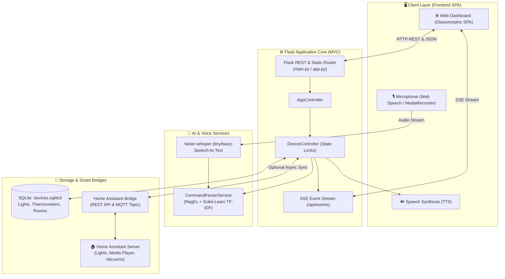
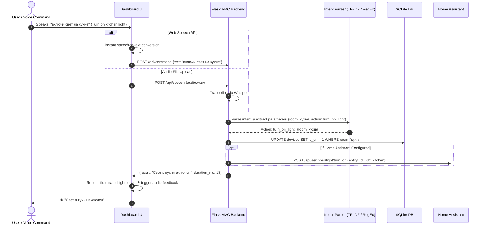

<div align="center">

# 🏠 SmartHome OS (web-Service_Home)
### Intelligent Smart Home Hub with Voice AI & Home Assistant Bridge
### Единая система управления умным домом с поддержкой голосового ИИ и интеграцией с Home Assistant

[](https://python.org)
[](https://flask.palletsprojects.com/)
[](https://www.home-assistant.io/)
[](https://github.com/SYSTRAN/faster-whisper)
[](https://scikit-learn.org/)

**[🇬🇧 English Version](#-english)** • **[🇷🇺 Русская версия](#-русский)**

</div>

---

<a name="-english"></a>
## 🇬🇧 English

### 📌 Overview
**SmartHome OS (`web-Service_Home`)** is a lightweight, offline-first Smart Home management hub designed with an MVC architecture (Model-View-Controller). It unifies lighting, temperature regulation, curtain automation, and robotic vacuum cleaners across home rooms into an intuitive glassmorphic dashboard with Dark and Light themes. The platform features dual-mode speech recognition (OpenAI Whisper + native Web Speech API fallback), a scikit-learn NLP intent classifier for Russian natural language parsing, and a bi-directional bridge to **Home Assistant** (REST API & MQTT).

---

### ✨ Key Features

- 🛋️ **Multi-Room Device Ecosystem**: Centralized state management for Rooms (Living Room, Kitchen, Bedroom, Bathroom) controlling lights, climate sensors, curtains, and robot vacuums.
- 🎙️ **Dual-Engine Voice Control**:
  - **Zero-Latency In-Browser Web Speech API**: Instant speech recognition directly in modern browsers without needing local GPU/CPU model loading.
  - **Server-Side Whisper (faster-whisper)**: Audio stream transcription on the backend for maximum offline accuracy.
- 🧠 **NLP Intent Classifier**: Hybrid semantic parser combining regular expressions and a trained scikit-learn (TF-IDF + Logistic Regression) pipeline for fuzzy Russian command understanding.
- ⚡ **Home Assistant Ecosystem Bridge**: Seamless dispatch of intents and device state calls to Home Assistant via REST API and MQTT pub/sub topics.
- 📡 **Real-time Server-Sent Events (SSE)**: Instant bi-directional state synchronization without page reloads or polling overhead.
- 🎨 **Glassmorphic Responsive UI**: Ultra-clean interface with Dark/Light modes, animated device toggles, live vacuum progress bars, speech synthesis (TTS) read-out, and toast notifications.

---

### 🏛️ System Architecture



---

### 🔄 Command Execution Pipeline



---

### 🚀 Quick Start (English)

#### Prerequisites
- **Python 3.9+** (Python 3.10 or 3.11 recommended)
- `pip` and virtual environment tool (`venv`)
- `git`

#### 1. Clone repository
```bash
git clone https://github.com/airwar31/web-Service_Home.git
cd web-Service_Home
```

#### 2. Create and activate virtual environment

**Linux / macOS:**
```bash
python3 -m venv venv
source venv/bin/activate
```

**Windows (PowerShell):**
```powershell
python -m venv venv
.\venv\Scripts\Activate.ps1
```

#### 3. Install dependencies
```bash
pip install -r requirements.txt
```

#### 4. Configure environment variables
Copy the template configuration:
```bash
cp .env.example .env
```
Edit `.env` (all external services are optional):
```ini
HOST=0.0.0.0
PORT=5000
DEBUG=False
USE_SSL=False

# Optional Home Assistant Integration
HA_URL=http://homeassistant.local:8123
HA_TOKEN=your_long_lived_access_token_here
```

#### 5. Run application

**Using Startup Scripts:**
- **Windows**: `.\start.bat`
- **Linux / macOS**: `chmod +x start.sh && ./start.sh`

**Manual command line:**
```bash
python main.py
```

Open your browser at:  
👉 **`http://localhost:5000`**

---

### 💬 Voice & Text Commands Reference

| Voice / Text Command | Recognized Action | System Behavior |
|---|---|---|
| `включи свет в зале` | `turn_on_light` | Turns on the living room light switch |
| `выключи свет на кухне` | `turn_off_light` | Turns off the kitchen light switch |
| `включи свет везде` | `turn_on_all` | Turns on all lights in all rooms |
| `выключи свет везде` | `turn_off_all` | Turns off all lights simultaneously |
| `открой шторы в спальне` | `open_curtain` | Sets curtain status to open |
| `закрой шторы в зале` | `close_curtain` | Sets curtain status to closed |
| `запусти пылесос в зале` | `start_vacuum` | Starts robot cleaner & triggers cleaning progress |
| `останови пылесос` | `stop_vacuum` | Halts vacuum cleaner and returns it to dock |
| `какая температура на кухне` | `get_temperature` | Reports room temperature & humidity |
| `статус устройств` | `get_status` | Comprehensive status summary of all sensors |

---

### 📡 REST API Reference

| Method | Endpoint | Description | Payload / Parameters |
|---|---|---|---|
| `GET` | `/` | Web Control Center Dashboard | HTML Page |
| `GET` | `/api/devices` | Get all devices and statuses | None |
| `POST` | `/api/command` | Execute natural language text command | `{"text": "включи свет в зале"}` |
| `POST` | `/api/speech` | Transcribe audio file to text & intent | Form-Data with `audio` file |
| `GET` | `/api/events` | Real-time Server-Sent Events (SSE) stream | Stream |
| `GET` | `/api/speech/status`| Whisper STT subsystem status check | None |
| `POST` | `/api/device_action`| Direct device toggle by id | `{"id": 1, "is_on": true}` |

---

<br />

---

<a name="-русский"></a>
## 🇷🇺 Русский

### 📌 Описание проекта
**SmartHome OS (`web-Service_Home`)** — это легковесный, автономный центр управления умным домом, построенный на современной архитектуре MVC (Model-View-Controller). Система объединяет управление освещением, климатом, шторами и роботом-пылесосом по комнатам в удобную панель с поддержкой темной и светлой темы. Сервис поддерживает распознавание голосовых команд на русском языке (нейросеть Whisper + мгновенный Web Speech API), семантический классификатор намерений на scikit-learn и мост интеграции с **Home Assistant** (REST API и MQTT).

---

### ✨ Ключевые возможности

- 🛋️ **Управление по комнатам**: единый мониторинг помещений (Зал, Кухня, Спальня, Ванная) с контролем света, микроклимата, штор и пылесоса.
- 🎙️ **Двойной голосовой ввод**:
  - **Мгновенный Web Speech API**: встроенное распознавание голоса прямо в браузере без задержек и без необходимости скачивать тяжелые модели.
  - **Серверный Whisper (faster-whisper)**: высокоточное распознавание аудиофайлов на бэкенде в полностью изолированном оффлайн-контуре.
- 🧠 **NLP-анализатор команд**: гибридный парсер намерений на базе регулярных выражений и обученного пайплайна scikit-learn (TF-IDF + логистическая регрессия).
- ⚡ **Мост к Home Assistant**: отправка команд и вызов сервисов Home Assistant по протоколам REST API и MQTT.
- 📡 **Мгновенная синхронизация (SSE)**: технология Server-Sent Events транслирует изменения статусов устройств в браузер в реальном времени.
- 🎨 **Современный интерфейс**: полупрозрачный дизайн с эффектом матового стекла (Glassmorphism), анимация переключателей, прогресс уборки пылесоса, голосовая озвучка ответов (TTS) и всплывающие тосты.

---

### 🚀 Быстрый старт (Русский)

#### 1. Клонирование репозитория
```bash
git clone https://github.com/airwar31/web-Service_Home.git
cd web-Service_Home
```

#### 2. Создание и активация виртуального окружения

**Linux / macOS:**
```bash
python3 -m venv venv
source venv/bin/activate
```

**Windows (PowerShell):**
```powershell
python -m venv venv
.\venv\Scripts\Activate.ps1
```

#### 3. Установка зависимостей
```bash
pip install -r requirements.txt
```

#### 4. Настройка файла .env
Скопируйте шаблон:
```bash
cp .env.example .env
```
Все внешние интеграции (Home Assistant, MQTT) опциональны — сервис полноценно работает из коробки со встроенной базой SQLite.

#### 5. Запуск сервиса

**Через готовые скрипты:**
- **Windows**: `.\start.bat`
- **Linux / macOS**: `chmod +x start.sh && ./start.sh`

**Вручную через терминал:**
```bash
python main.py
```

Панель управления будет доступна по адресу:  
👉 **`http://localhost:5000`**

---

### 📂 Структура проекта / Project Structure

```text
web-Service_Home/
├── app/
│   ├── controllers/
│   │   ├── app_controller.py         # Главный координатор приложения
│   │   └── device_controller.py      # Контроллер устройств, таймеров и Home Assistant
│   ├── models/
│   │   ├── command.py                # Модель структуры команд и намерений
│   │   ├── database.py               # Модель взаимодействия с SQLite
│   │   └── device.py                 # Классы устройств, комнат и состояния
│   ├── services/
│   │   ├── command_parser_service.py # Парсер естественного языка и классификатор
│   │   └── speech_service.py         # Сервис транскрибации речи Whisper
│   └── utils/
│       └── file_utils.py             # Безопасная работа с файлами и временными путями
├── backend/
│   ├── command_parser.py             # Базовый парсер команд по регулярным выражениям
│   ├── config.py                     # Конфигурация комнат и локаций
│   ├── db.py                         # Низкоуровневые SQLite функции
│   ├── home_assistant_bridge.py      # Мост взаимодействия с Home Assistant (REST/MQTT)
│   ├── speech_recognizer.py          # Модуль интеграции с faster-whisper
│   └── models/
│       ├── command_classifier.py     # TF-IDF модель классификации намерений
│       └── command_model.pkl         # Сериализованная модель классификатора
├── config/
│   └── settings.py                   # Централизованные настройки приложения
├── docs/                             # Описание кейса и презентация хакатона
├── frontend/                         # Статические файлы фронтенда
│   ├── index.html                    # Разметка панели управления
│   ├── main.css                      # Таблицы стилей (Glassmorphic)
│   └── script.js                     # Логика SPA-клиента
├── static/                           # Статика для MVC шаблонов
│   ├── css/main.css                  # CSS стили темы
│   ├── js/script.js                  # JavaScript контроллер
│   └── templates/index.html          # Шаблон главной страницы
├── .env.example                      # Шаблон переменных окружения
├── .gitignore                        # Исключения версионного контроля
├── requirements.txt                  # Зависимости Python
├── main.py                           # Рекомендуемая точка входа (MVC сервер)
├── app.py                            # Монолитная точка входа
├── start.bat                         # Скрипт запуска для Windows
├── start.sh                          # Скрипт запуска для Linux/macOS
└── README.md                         # Двуязычная документация проекта
```

---

### 🛡️ Безопасность / Security

- **Изоляция секретов**: Все токены Home Assistant, ключи OpenAI и сетевые настройки вынесены в переменные окружения (`.env`) и не попадают в систему контроля версий.
- **Безопасные SSL-ключи**: Закрытые ключи (`*.key`, `*.pem`) исключены из репозитория. Предусмотрен режим `adhoc` для локальной генерации сертификатов.
- **Безопасная обработка файлов**: Аудиозаписи валидируются по формату и сохраняются с использованием криптографически стойких уникальных имен (`secrets.token_hex`).

---

### 📄 Авторские права / Copyright

Copyright (c) 2024-2026 Danila ([airwar31](https://github.com/airwar31)). Все права защищены / All rights reserved.
